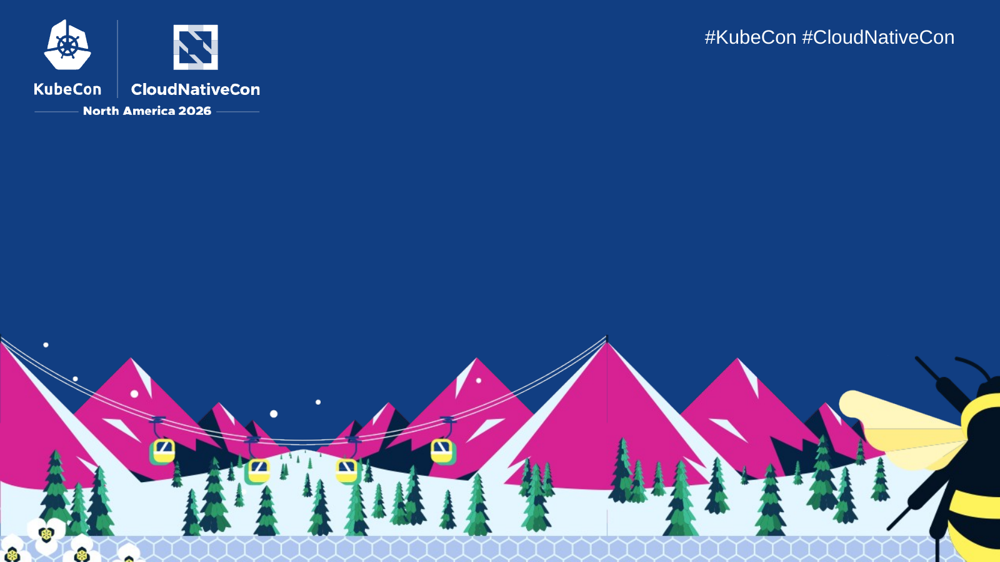
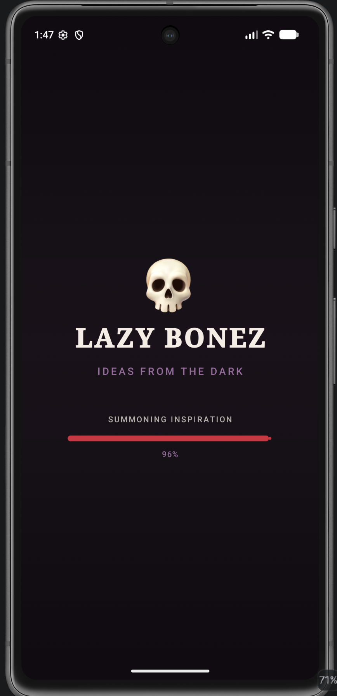

---
# try also 'default' to start simple
# theme: seriph
theme: default
# random image from a curated Unsplash collection by Anthony
# like them? see https://unsplash.com/collections/94734566/slidev
# background: https://cover.sli.dev
# some information about your slides (markdown enabled)
title: OpenTelemetry In Your Pocket
info: |
  ## OpenTelemetry In Your Pocket
  
  A guide to the OpenTelemetry Android Agent DSL

  https://github.com/breedx-splk/kubecon_na_2026
# apply UnoCSS classes to the current slide
class: cncf-title bright-subtitle
layout: default
hideFooter: true
# https://sli.dev/features/drawing
drawings:
  persist: false
# slide transition: https://sli.dev/guide/animations.html#slide-transitions
transition: slide-left
# enable Comark Syntax: https://comark.dev/syntax/markdown
comark: true
# duration of the presentation
duration: 30min

---

<!-- Original intro slide, kept for reference:
---
layout: cover
class: text-center
---

# OpenTelemetry<br/>In Your Pocket

### <span class="android-green">A guide to the OpenTelemetry<br/>Android Agent DSL</span>

Jason Plumb (Splunk)
-->

<!-- Branding: CNCF / The Linux Foundation. Background rendered from the official
KubeCon_CloudNativeCon_North_America_2026_-_Branded_PowerPoint.pptx title slide,
attached to the speaker email dated November 3, 2026.
Event: https://events.linuxfoundation.org/kubecon-cloudnativecon-north-america/ -->


<div class="cncf-title-content">
  <h1>OpenTelemetry<br/>In Your Pocket</h1>
  <p class="cncf-title-subtitle">A guide to the OpenTelemetry Android Agent DSL</p>
  <p class="cncf-title-speaker">Jason Plumb (Splunk)</p>
</div>

---
layout: two-cols
---

# About me


::right::

<div class="h-10"></div>

## Jason Plumb <span class="text-sm">(he/him)</span>

## 30 years in industry

## 10 years in Observability

## I work at Splunk

<div class="h-10"></div>

- [breedx-splk](https://github.com/breedx-splk) (GitHub)
- [opentelemetry-android](https://github.com/open-telemetry/opentelemetry-android)
- [opentelemetry-kotlin](https://github.com/open-telemetry/opentelemetry-kotlin)
- [opentelemetry-java*](https://github.com/orgs/open-telemetry/repositories?q=java)

<style>
ul {
  font-size: 1.5rem;
}
</style>

---
class: generous-left-pad generous-top-pad bright-subtitle double-text
---

# About this talk

<span class="android-green">What we are going to cover today:</span>

* A little background
* How OTel facilitates RUM
* Features of OTel Android
* <span class="android-green">The DSL</span>
* Live demo!
* What lies ahead...
* <span class="android-green">Q&A</span>

---
class: generous-left-pad2 generous-top-pad bright-subtitle double-text
---

# Assumptions


<br/>

* Basic knowledge of o11y signals
  * <span class="text-lg">traces, logs, events, metrics</span>
* You have heard of OpenTelemetry
  * <span class="text-lg">tracer, span processor, sampler, etc</span>
* You might have used <span class="android-green">Android</span>

---
layout: image
title: agent
image: ./agent_v2.gif
backgroundSize: 92% auto
---

---
class: generous-left-pad2 generous-top-pad bright-subtitle double-text
---

# Background

<!-- Image credit: My Reading Vintage, https://myreadingvintage.com/cdn/shop/articles/books_with_history.png -->

<br/>

* originally [splunk-otel-android](https://github.com/signalfx/splunk-otel-android)
* offered to OTel in [March 2023](https://github.com/open-telemetry/community/issues/1400)
  * accepted in July 2023
* supported by Elastic and Embrace
  * (and many others!)

---
class: generous-left-pad2 generous-top-pad bright-subtitle double-text
---

# Even Moar Background
<br/>

* primarily java at the time
* limited instrumentation
* only emitted Spans
  * predates <span class="android-green">OTel</span> events
* very limited demo app
* bespoke, wild semconv

---
class: generous-left-pad2 generous-top-pad bright-subtitle double-text
---

# <span class="android-green leading-normal">How does OTel Android facilitate RUM?</span>

* RUM -> "real user monitoring"
* nomenclature: RUM vs. DEM
  * "digital experience monitoring"
* UX enhancements
* Deeper understanding of user interactions.

---
class: generous-left-pad2 generous-top-pad bright-subtitle double-text
---

# <span class="android-green leading-normal">How does OTel Android facilitate RUM?</span>

* troubleshooting in production (lol)
* correlate user actions to backend 
* spans for network, activity, fragment
* events for most things (click, crash, etc)

---
class: generous-left-pad2 generous-top-pad bright-subtitle double-text
---

# <span class="android-green leading-normal">Features of OTel Android</span><br/><span class="text-lg">((1 of 4))</span>

<!-- Image credit: Kotlin logo by JetBrains, via Wikimedia Commons (public domain): https://commons.wikimedia.org/wiki/File:Kotlin_Icon.png -->


* Kotlin
  * JVM language
  * standard for Android development
  * some use of [`otel-kotlin`](https://github.com/open-telemetry/opentelemetry-kotlin)

---
class: generous-left-pad2 generous-top-pad bright-subtitle double-text
---

# <span class="android-green leading-normal">Features of OTel Android</span><br/><span class="text-lg">((2 of 4))</span>


* Lots of instrumentation
  * clicks, crashes, screens, orientation, network, ...
* Some build-time instrumentation
  * http clients

---
class: generous-left-pad2 generous-top-pad bright-subtitle double-text
---

# <span class="android-green leading-normal">Features of OTel Android</span><br/><span class="text-lg">((3 of 4))</span>


* Session management
* Simplified event api
* Semantic conventions
* OTel Demo app
* Telemetry disk buffering

---
class: generous-left-pad2 generous-top-pad bright-subtitle double-text
---

# <span class="android-green leading-normal">Features of OTel Android</span><br/><span class="text-lg">((4 of 4))</span>


* Creating an OTel SDK instance
  * autoconfigure 🤔
  * super configurable and complex!
* (currently the otel-java SDK)

---
class: text-center centered-hero
---

# 1.0.0<br/><span class="android-green">Jan 2026</span>

---
class: text-center centered-hero
---

# ((stable))<br/><span class="android-green">android-agent</span>

---
class: android-modules-slide
---


---
class: text-center centered-hero
---

# <span class="android-green">((also stable))</span><br/><span class="text-lg">agent-api, instrumentation-api, session-api, </span>

---
class: android-modules-slide
---


---
class: text-center centered-hero
---

# <span class="android-green">((development))</span><br/><span class="text-lg">instrumentation, semconv, sessions, etc</span>

---
class: text-center centered-hero
---

# THE DSL<br/><span class="android-green">(android-agent)</span>

---
class: generous-left-pad2 generous-top-pad bright-subtitle double-text
---
# What's this <span class="android-green">DSL</span>?

<!-- Image credit: Anup Debnath / Vecteezy, "3D Fire Emoji Burning Brightly with
Glowing Orange and Red Tones Isolated on Transparent Background".
Source: https://www.vecteezy.com/png/60120000-3d-fire-emoji-burning-brightly-with-glowing-orange-and-red-tones-isolated-on-transparent-background -->


* a Kotlin (D)omain (S)pecific (L)anguage
* Type-safe configuration
* A set of reasonable defaults<br/><br/>
* makes it easy to init OpenTelemetryRum and the underlying OTel Java SDK

---
class: larger-code
---
# Android Agent <span class="android-green">DSL</span> Example

```kotlin
rum = OpenTelemetryRumInitializer.initialize(
        context = this@OtelDemoApplication,
        configuration = {
          httpExport {
            baseUrl = "http://10.0.2.2:4318"
          }
          globalAttributes {
            Attributes.of(stringKey("toolkit"), "jetpack compose")
          }
          ...
        })
```

---
class: larger-code bright-subtitle
---
# Adding to your Application

<!-- Image credit: Market Prospects, https://www.market-prospects.com/storage/images/301-1200x675.jpg -->


&nbsp;

In your `build.gradle.kts`:

```kotlin
implementation(
  platform("io.opentelemetry.android:opentelemetry-android-bom:1.8.1-alpha")
)
implementation("io.opentelemetry.android:android-agent")
```

In your `Application.onCreate()`:

```kotlin
OpenTelemetryRumInitializer.initialize(
    context = this@YourAppClass,
    configuration = {
    ... // all DSL config here
    })
```

---
class: larger-code
---

# Configuring <span class="android-green">exporters</span>

```kotlin
httpExport {
    baseUrl = "http://10.0.2.2:4318"
    headerSupplier { mapOf("user.id" to getUserId()) }
    compression = Compression.GZIP
    clientTls = ClientTlsConnectivity(pk, cert)
    spans {
        compression = Compression.NONE
        fullUrl = "https://example.com:8067/spans"
    }
}
```
---
class: larger-code
---

# Configuring <span class="android-green">disk buffering</span>

```kotlin
diskBuffering {
    maxCacheSize = 5 * 1024*1024
    exportPeriod = 5.minutes
    telemetryStorageDir = File("/data/user/0/com.lazybonez/cache/otlp")
}
```
---
class: larger-code !pl-20
---

# Configuring <span class="android-green">instrumentation</span>

```kotlin
instrumentations {
  suppressing (
      "unwanted.instrumentation.name",
      "something.unwanted"
  )
  crashReporter {
      enabled(true)
  }
  slowRenderingReporter {
      detectionPollInterval(300.milliseconds)
      enableVerboseDebugLogging()
  }
  screenOrientation {
      enabled(false)
  }
}
```

---
class: larger-code !pl-20
---

# Misc other <span class="android-green">config</span>

```kotlin
sampler {
    trace { SessionIdRatioBasedSampler(0.5, it) }
}
semanticConventions {
    useLatestExperimental = false
}
resource {
    put("service.name", "lazy-bonez")
    put("service.version", BuildConfig.VERSION_NAME)
    put("deployment.environment.name", "demo")
}
session {
    backgroundInactivityTimeout = 30.seconds
    maxLifetime = 2.hours
}

```

---
layout: two-cols
title: demo
class: flex items-center justify-center
---

<h1 class="!text-7xl !m-0">demo</h1>

::right::



---
class: text-center centered-hero bright-subtitle
---
# ...

---
class: text-center centered-hero bright-subtitle
---
# wHy nOt dECLaRaTiVe coNfIG???

<!-- Image source: ImageResizer, https://imageresizer.com/meme-generator/edit/Y-U-no-guy -->


---
class: generous-left-pad2 generous-top-pad bright-subtitle double-text
---
# (Y U NO <span class="android-green">declarative config</span>)

* startup time on mobile
* loading files is mostly verboten
* isn't this DSL kinda declarative?

---
class: generous-left-pad2 generous-top-pad bright-subtitle double-text
---
# "<span class="android-green">It's so limiting</span>"

<!-- Photo credit: "Denver Boot, Close-up" by artistmac, via Flickr.
Source: https://www.flickr.com/photos/26329029@N06/5461328339/
License: CC BY-SA 2.0, https://creativecommons.org/licenses/by-sa/2.0/
Image used unchanged. -->


* intentionally started small
* open to extension
  * PRs welcome!<br/><br/>
* you can always still create your own 
  instance of the otel sdk if you _really_
  need to... 😜

---
class: generous-left-pad2 generous-top-pad bright-subtitle double-text
---
# What's ahead

* more DSL features being added
* see our [ROADMAP.md](https://github.com/open-telemetry/opentelemetry-android/blob/main/docs/ROADMAP.md)
* 

---
class: qna-qr-slide
---
# 🤘🏻 <span class="android-green">THANK YOU</span> / Q&A 🤘🏻

<div class="qna-qr-grid">
  <div class="qna-qr-column">
    <h2>Slides + App</h2>
    
  </div>
  <div class="qna-qr-column">
    <h2>Session feedback</h2>
    
  </div>
</div>
