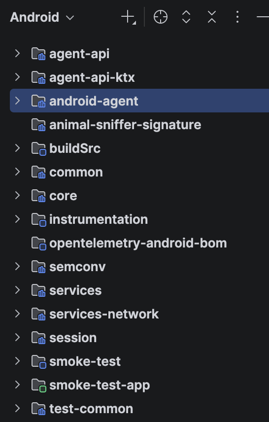
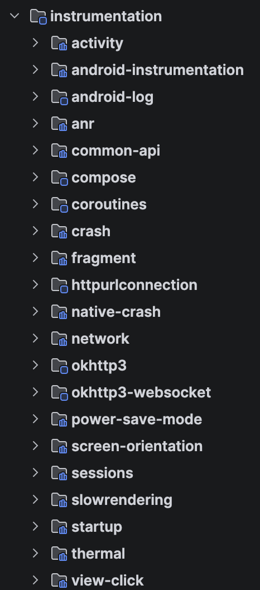
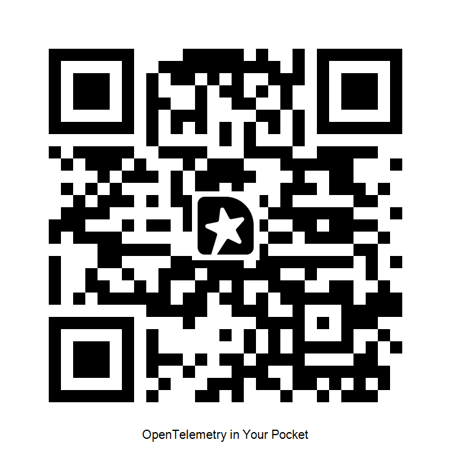

---
# try also 'default' to start simple
# theme: seriph
theme: default
# random image from a curated Unsplash collection by Anthony
# like them? see https://unsplash.com/collections/94734566/slidev
# background: https://cover.sli.dev
# some information about your slides (markdown enabled)
title: OpenTelemetry In Your Pocket
info: |
  ## OpenTelemetry In Your Pocket
  
  A guide to the OpenTelemetry Android Agent DSL

  https://github.com/breedx-splk/kubecon_na_2026
# apply UnoCSS classes to the current slide
class: text-center
# https://sli.dev/features/drawing
drawings:
  persist: false
# slide transition: https://sli.dev/guide/animations.html#slide-transitions
transition: slide-left
# enable Comark Syntax: https://comark.dev/syntax/markdown
comark: true
# duration of the presentation
duration: 30min

---

# OpenTelemetry<br/>In Your Pocket

### <span class="android-green">A guide to the OpenTelemetry<br/>Android Agent DSL</span> 

Jason Plumb (Splunk)

---
layout: two-cols
---

# About me


::right::

<div class="h-10"></div>

## Jason Plumb <span class="text-sm">(he/him)</span>

## 30 years in industry

## 10 years in Observability

## I work at Splunk

<div class="h-10"></div>

- [breedx-splk](https://github.com/breedx-splk) (GitHub)
- [opentelemetry-android](https://github.com/open-telemetry/opentelemetry-android)
- [opentelemetry-kotlin](https://github.com/open-telemetry/opentelemetry-kotlin)
- [opentelemetry-java*](https://github.com/orgs/open-telemetry/repositories?q=java)

<style>
ul {
  font-size: 1.5rem;
}
</style>

---
class: generous-left-pad generous-top-pad bright-subtitle double-text
---

# About this talk

<span class="android-green">What we are going to cover today:</span>

* A little background
* How OTel facilitates RUM
* Features of OTel Android
* <span class="android-green">The DSL</span>
* Live demo!
* What lies ahead...
* <span class="android-green">Q&A</span>

---
class: generous-left-pad2 generous-top-pad bright-subtitle double-text
---

# Assumptions


<br/>

* Basic knowledge of o11y signals
  * <span class="text-lg">traces, logs, events, metrics</span>
* You have heard of OpenTelemetry
  * <span class="text-lg">tracer, span processor, sampler, etc</span>
* You might have used <span class="android-green">Android</span>

---
class: generous-left-pad2 generous-top-pad bright-subtitle double-text
---

# Background

<!-- Image credit: My Reading Vintage, https://myreadingvintage.com/cdn/shop/articles/books_with_history.png -->

<br/>

* originally [splunk-otel-android](https://github.com/signalfx/splunk-otel-android)
* offered to OTel in [March 2023](https://github.com/open-telemetry/community/issues/1400)
  * accepted in July 2023
* supported by Elastic and Embrace
  * (and many others!)

---
class: generous-left-pad2 generous-top-pad bright-subtitle double-text
---

# Even Moar Background
<br/>

* primarily java at the time
* limited instrumentation
* only emitted Spans
  * predates <span class="android-green">OTel</span> events
* very limited demo app
* bespoke, wild semconv

---
class: generous-left-pad2 generous-top-pad bright-subtitle double-text
---

# <span class="android-green leading-normal">How does OTel Android facilitate RUM?</span>

* RUM -> "real user monitoring"
* nomenclature: RUM vs. DEM
* UX enhancements
* Deeper understanding of user interactions.

---
class: generous-left-pad2 generous-top-pad bright-subtitle double-text
---

# <span class="android-green leading-normal">How does OTel Android facilitate RUM?</span>

* troubleshooting in production (lol)
* correlate user actions to backend 
* spans for network, activity, fragment
* events for most things (click, crash, etc)

---
class: generous-left-pad2 generous-top-pad bright-subtitle double-text
---
# <span class="android-green leading-normal">Features of OTel Android</span>

<!-- Image credit: Kotlin logo by JetBrains, via Wikimedia Commons (public domain): https://commons.wikimedia.org/wiki/File:Kotlin_Icon.png -->


* Kotlin
  * JVM language
  * standard for Android development
  * some use of [`otel-kotlin`](https://github.com/open-telemetry/opentelemetry-kotlin)

---
class: generous-left-pad2 generous-top-pad bright-subtitle double-text
---

# <span class="android-green leading-normal">Features of OTel Android</span>

* Lots of instrumentation
  * clicks, crashes, screens, network, ...
* Some build-time instrumentation
  * http clients

---
class: generous-left-pad2 generous-top-pad bright-subtitle double-text
---

# <span class="android-green leading-normal">Features of OTel Android</span>

* Session management
* Simplified event api
* Semantic conventions
* OTel Demo app
* Telemetry disk buffering

---
class: generous-left-pad2 generous-top-pad bright-subtitle double-text
---
# <span class="android-green leading-normal">Features of OTel Android</span>

* Creating an OTel SDK instance
  * autoconfigure 🤔
  * super configurable and complex!
* (currently the otel-java SDK)

---
class: text-center centered-hero
---

# 1.0.0<br/><span class="android-green">Jan 2026</span>

---
class: text-center centered-hero
---

# ((stable))<br/><span class="android-green">android-agent</span>

---
class: android-modules-slide
---


---
class: text-center centered-hero
---

# <span class="android-green">((also stable))</span><br/><span class="text-lg">agent-api, instrumentation-api, session-api, </span>

---
class: android-modules-slide
---



---
class: text-center centered-hero
---

# <span class="android-green">((development))</span><br/><span class="text-lg">instrumentation, semconv, sessions, etc</span>

---
class: text-center centered-hero
---

# THE DSL<br/><span class="android-green">(android-agent)</span>

---
class: generous-left-pad2 generous-top-pad bright-subtitle double-text
---
# What's this <span class="android-green">DSL</span>?

* a Kotlin (D)omain (S)pecific (L)anguage
* Type-safe configuration
* A set of reasonable defaults

---
class: larger-code
---
# Android Agent <span class="android-green">DSL</span> Example

```kotlin
rum = OpenTelemetryRumInitializer.initialize(
        context = this@OtelDemoApplication,
        configuration = {
          httpExport {
            baseUrl = "http://10.0.2.2:4318"
          }
          globalAttributes {
            Attributes.of(stringKey("toolkit"), "jetpack compose")
          }
          ...
        })
```

---
class: larger-code
---

# Configuring <span class="android-green">instrumentation</span>

```kotlin
instrumentations {
  suppressing (
      "unwanted.instrumentation.name",
      "something.unwanted"
  )
  crashReporter {
      enabled(true)
  }
  slowRenderingReporter {
      detectionPollInterval(300.milliseconds)
      enableVerboseDebugLogging()
  }
  screenOrientation {
      enabled(false)
  }
}
```

---
class: larger-code
---

# Configuring <span class="android-green">exporters</span>

```kotlin
httpExport {
    baseUrl = "http://10.0.2.2:4318"
    headerSupplier { mapOf("user.id" to getUserId()) }
    compression = Compression.GZIP
    clientTls = ClientTlsConnectivity(pk, cert)
    spans {
        compression = Compression.NONE
        fullUrl = "https://example.com:8067/spans"
    }
}
```
---
class: larger-code
---

# Configuring <span class="android-green">disk buffering</span>

```kotlin

```


---
class: larger-code
---
# Adding to your Application

&nbsp;

In your `Application.onCreate()`:

```kotlin
implementation(
  platform("io.opentelemetry.android:opentelemetry-android-bom:1.8.1-alpha")
)
runtimeOnly("io.opentelemetry.android:android-agent")
```
---
class: text-center centered-hero
---
# Why not DECLARATIVE CONFIG???

reasons

---
class: text-center centered-hero
---
# "It's so limiting"

* intentionally started small
* open to extension
  * PRs welcome!

---
class: qna-qr-slide
---
# THANK YOU / Q&A

<div class="qna-qr-grid">
  <div class="qna-qr-column">
    <h2>Slides + App</h2>
    
  </div>
  <div class="qna-qr-column">
    <h2>Session feedback</h2>
    
  </div>
</div>

---
layout: two-cols
---

---
---
# What's ahead

* more DSL features being added

# Left

chud

::right::

# Right

pud

---
class: generous-left-pad
---
# test

some java for you

why is this not bold

```java
String foo = "love";
doSomething(foo);
```

and this is apparently kotlin

but what about this

```kotlin
thing { 
    doSomething { 
        foo: "bar"
        bar: baz
        beep: execute("it")
    }
}
```

---
---

# test

flim

flam
